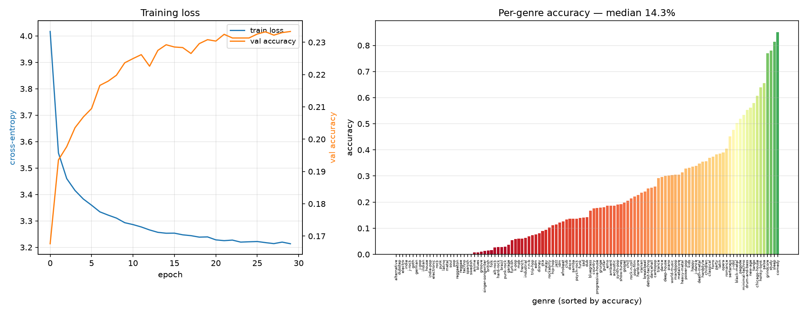
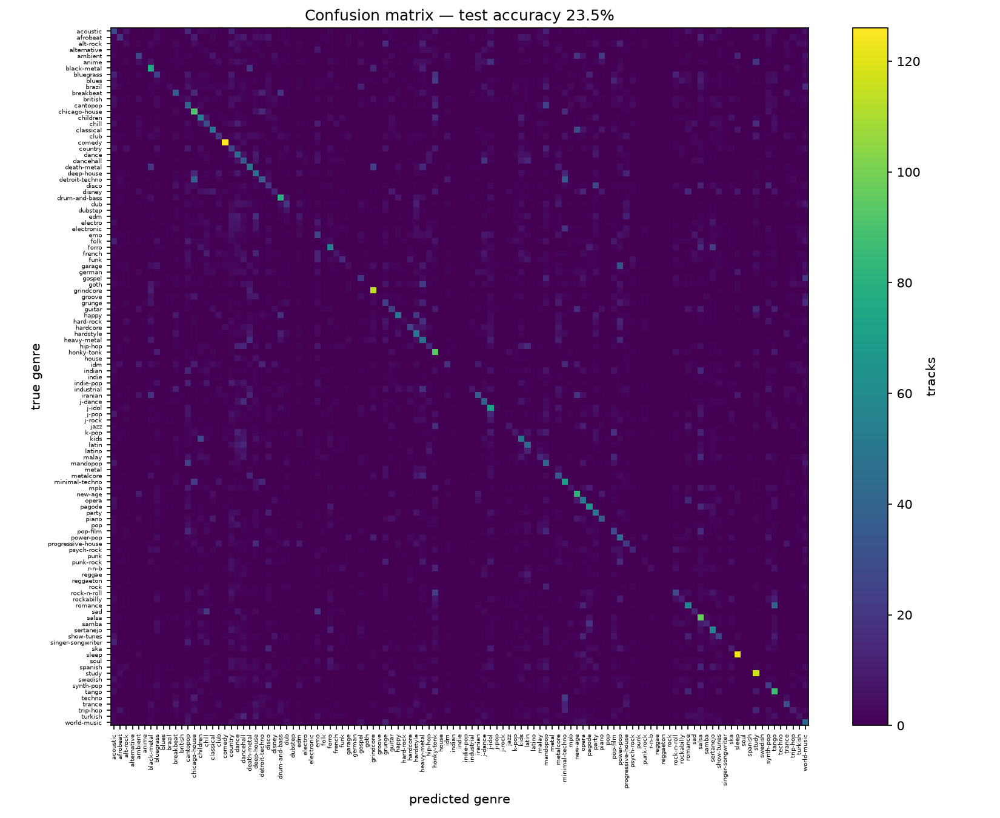
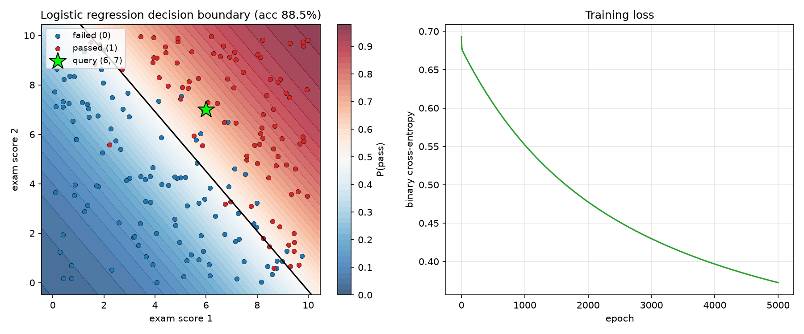
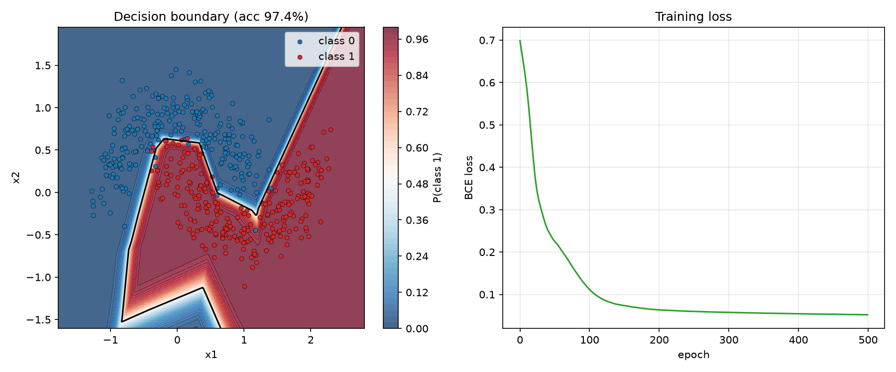

# Spotify Genre Classifier

Predicting the genre of a Spotify track from its audio features using a PyTorch neural network, plus a set of from-scratch ML exercises (logistic regression, MLPs, handwritten digits).

## Contents

| File | Description |
|------|-------------|
| `spotify_genre.py` | Main project — 14-feature neural network classifying tracks into genres, with training curves and confusion matrix plots |
| `Logi_reg.py` | Logistic regression implemented from scratch in NumPy (exam pass/fail dataset) |
| `ML.py` | Two-layer MLP on the `make_moons` dataset (PyTorch) with decision-boundary visualization |
| `neural_net.py` | From-scratch neural net (NumPy) classifying handwritten digits |
| `make_dataset.py` | Generates the synthetic exam dataset (`exam.npy`, `passed.npy`) |
| `spotify_classifier_math.pdf` | Math write-up of the model and training procedure |

## Setup

```bash
pip install numpy pandas scikit-learn matplotlib torch
```

The Spotify dataset comes from the [Spotify Tracks Dataset](https://www.kaggle.com/datasets/maharshipandya/-spotify-tracks-dataset) on Kaggle. Update the `CSV` path at the top of `spotify_genre.py` to point at your local copy (it is fetched with `kagglehub` by default).

## Run

```bash
python make_dataset.py   # build the synthetic exam data
python Logi_reg.py       # from-scratch logistic regression
python ML.py             # moons MLP
python neural_net.py     # digits classifier
python spotify_genre.py  # Spotify genre classifier (main project)
```

## Model

- **Features (14):** duration, explicit flag, danceability, energy, key, loudness, mode, speechiness, acousticness, instrumentalness, liveness, valence, tempo, time signature
- **Architecture:** `14 → 128 → 64 → n_genres` (ReLU, dropout 0.2)
- **Training:** Adam (lr 1e-3, step decay at epochs 12 & 20), cross-entropy, 30 epochs, batch size 256, standardized features, stratified 70/15/15 split

## Results

### Training curves & per-genre accuracy



### Confusion matrix



### Other exercises

| Logistic regression | Moons MLP |
|---|---|
|  |  |
